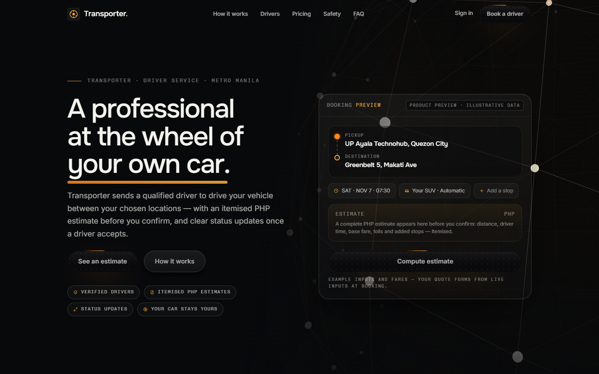
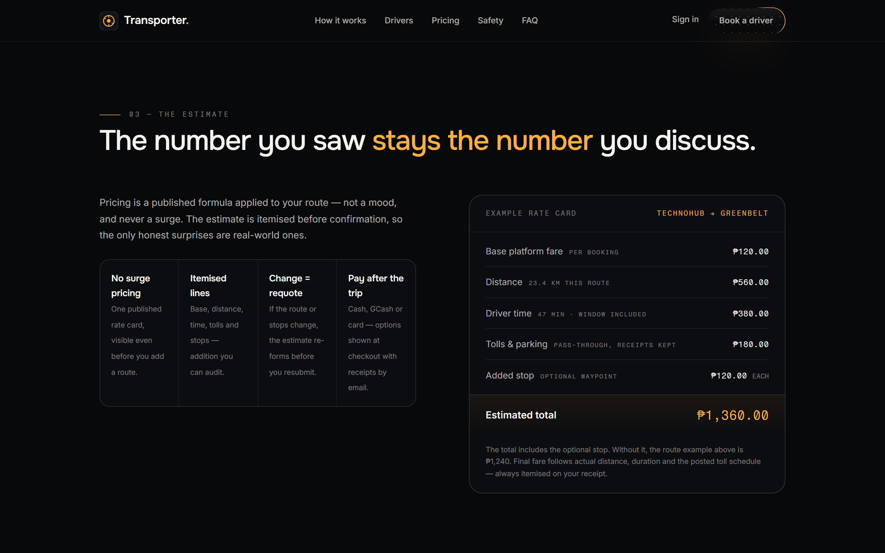
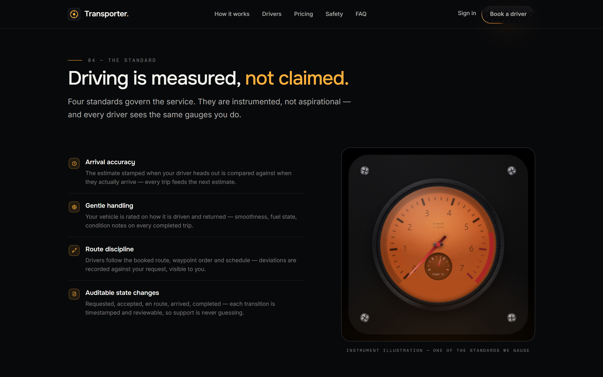
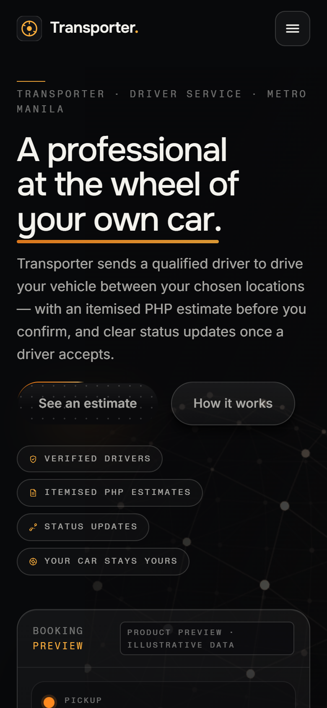
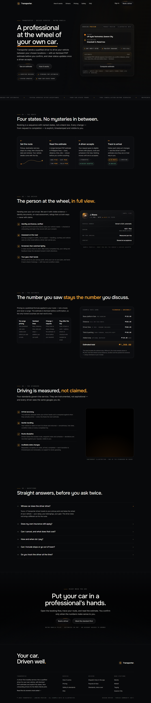

# Transporter — landing page

A single-page marketing site for **Transporter**: a Metro Manila pilot service that sends a
qualified, vetted driver to drive *your own car* between your chosen locations — with an
itemised PHP estimate before you confirm, and auditable status updates once a driver accepts.

Built as a design exploration using the free, MIT-licensed components from
[ThreeUI Community](https://github.com/MengTo/threeui), re-skinned into a
**night-drive instrumentation** aesthetic: near-black asphalt canvas, signal-amber accents,
glass panels, mono telemetry labels, and editorial section numbering (01 — THE ROUTE … 05 — QUESTIONS).

## Screenshots

Captured from the **live production site** (`transporter.transporter-landing.workers.dev`),
not a dev server. Higher-res originals live in `docs/screenshots/` — click any image to open it full-size.

<p align="center">
  <a href="docs/screenshots/hero.png"></a><br/>
  <em>Hero — interactive booking-preview card: route, timing and estimate, computed live</em>
</p>

| 03 — Pricing (published rate card) | 04 — Standards (instrumented gauges) |
| --- | --- |
| <a href="docs/screenshots/pricing.png"></a> | <a href="docs/screenshots/standards.png"></a> |

<p align="center">
  <a href="docs/screenshots/cta-band.png"></a><br/>
  <em>CTA band — halftone flow field behind the closing call to action</em>
</p>

<p align="center">
  <a href="docs/screenshots/mobile-hero.png"></a><br/>
  <em>Mobile (390 px) — hamburger navigation, stacked utility pills, booking sheet</em>
</p>

<details>
<summary><strong>Full-length page capture (desktop, 1440 px)</strong></summary>
<p align="center"><a href="docs/screenshots/full-page.png"></a></p>
</details>

---

## Tech stack

| Layer | Choice | Why |
| --- | --- | --- |
| Build | Vite 7 + TypeScript 5.9 | instant HMR, single-page static output |
| UI | React 19 | function components only, no class legacy |
| Styling | Tailwind v4 (preflight/utilities only) + hand-written `src/index.css` design system | the design language lives in one place: custom properties + small classes |
| Motion | `motion` v12 (Framer Motion) | scroll-reveal, respects `prefers-reduced-motion` |
| 3D / effects | `@designcodeio/threeui` (npm, MIT) | WebGL scenes shipped as sandboxed iframes |
| Type | Onest Variable (display), Inter Variable (body), Fragment Mono (telemetry) via Fontsource | self-hosted, no runtime font CDN |

No CSS-in-JS, no component library beyond ThreeUI, no analytics. The page is fully static and
renders without JavaScript for content (JS only adds reveals, the demo card, and lazy WebGL).

## ThreeUI usage

**Imported from `@designcodeio/threeui` as-is** (decorative, `aria-hidden`, `pointer-events: none`,
mounted lazily just before they enter the viewport via `src/components/ui.tsx → <Field>`):

| Component | Where | Notes |
| --- | --- | --- |
| `TopologyField` | hero backdrop | scene's glowing core sits at 20% of the iframe width — the CSS crop (`inset: -30% -6% -14% 41%`) places that point in the gap between copy and booking card; a CSS `sepia/hue-rotate` filter warms the monochrome scene toward the amber palette |
| `PerformanceGauges` (`variant="tachometer"`) | 04 — THE STANDARD | inside a `.gaugecard` glass square |
| `HalftoneFlow` | CTA band | dimmed via `brightness` prop + gradient overlay so text keeps contrast |

**Adapted / vendored rather than iframed** (re-authored as real accessible DOM + CSS, MIT-licensed original):

- `GradientBeamCta` → `src/components/BeamCta.tsx` — a real `<a>`/`<button>` with a rotating
  conic amber beam behind a glass pill (`isolation: isolate` fixes the stacking context).
- `SlidingTextCta` → `src/components/SlideCta.tsx` — real anchor, tweaked travel/sizing.
- `articleHeadingDecode` → `src/lib/articleHeadingDecode.ts` + `src/lib/useDecodeOnView.ts` —
  the scramble/decode text effect, wired to `SectionKicker` and gated on first in-view + reduced-motion.

**Skipped**: components whose hardcoded copy didn't fit a PH car-service (AnimatedTopDock,
ArticleHeadings, EditorialIntroSection, NewsletterFooterSection, LumenCta — wrong palette).

## Page anatomy

Nav (glass, hamburger sheet) → Hero (headline + interactive booking-card preview, labelled
“PRODUCT PREVIEW · ILLUSTRATIVE DATA”) → ticker strip → 01 How it works (4 stages) →
02 Drivers (checks + sample driver card) → 03 Pricing (published rate card; numbers stay
consistent with the hero demo: base 120 + distance 560 + time 380 + tolls 180 = ₱1,240,
optional stop +120 = ₱1,360) → 04 Standards (tachometer) → 05 FAQ (`details/summary`) →
CTA band → footer.

## Product-correctness rules baked in

Per `docs/01_PROJECT_CHARTER.md`:

- **Evidence over claims** — the hero card is explicitly tagged as a product preview with
  illustrative data; the pricing section sources its numbers to the published formula; no fake
  live ETAs, availability ticks, or fake user counts anywhere.
- **Progressive disclosure** — pinch-of-summary sections, itemised estimate only revealed by the
  user in the demo.
- **Accessible motion** — every animation (reveals, beam, ticker, sweep, dash runs) is disabled
  under `prefers-reduced-motion: reduce`; the WebGL fields are `aria-hidden` decoration.
- **Forward-compatible honesty** — `?static` renders the page fully settled (no observers) for
  deterministic screenshots; the same floor can be used by future e2e suites.

## Getting started

```bash
npm install
npm run dev        # http://localhost:5173
npm run build      # typecheck + static build → dist/
npm run preview    # serve the production build
```

### Screenshot tooling (optional, uses system Edge via playwright-core)

```bash
node scripts/shot.mjs "http://localhost:5173/?static" .shots/full.png 1440 900 full
node scripts/inspect.mjs      # element shots of each decorative iframe + error log
node scripts/sections.mjs     # scrolled viewport shots: standards, cta, pricing
node scripts/mshots.mjs       # 390px mobile: hero + gauge card
```

## Deployment (Cloudflare, free tier)

Live at **https://transporter3.pages.dev** — legacy Cloudflare Pages project `transporter3`
(direct upload), served from Cloudflare's edge: unlimited bandwidth/requests, free HTTPS, no
credit card. Fallback copy on the identical build stays up at the older URL:
https://transporter.transporter-landing.workers.dev (a Workers deployment kept as a backup).

Deployed via `wrangler v4` with the legacy Pages flow (`wrangler` 4 otherwise delegates new
projects to Workers; the project itself was created through the Pages REST API):

```bash
npx wrangler login      # one-time OAuth (browser)
npm run deploy          # build → clean-pages.mjs → wrangler pages deploy (project transporter3)
```

- `scripts/clean-pages.mjs` strips the `@cloudflare/vite-plugin` Worker artifacts
  (`dist/wrangler.json`, `dist/.assetsignore`) before the Pages upload.
- Local `wrangler dev` preview is wired to `npm run preview` (uses the Worker fallback).

### Continuous deployment (GitHub → Cloudflare)

Source: <https://github.com/aldrinpm/transporter3> (public). Every push to `main` runs
`.github/workflows/deploy.yml` → `wrangler pages deploy transporter3` → updated site is live
~2 min later at https://transporter3.pages.dev. Requires repo secrets `CLOUDFLARE_API_TOKEN`
(**Cloudflare Pages: Edit** + Account Settings: Read) and `CLOUDFLARE_ACCOUNT_ID`; manual
runs available via *workflow_dispatch*.

## Project layout

```
src/
  index.css            # full design system: tokens, buttons (.beam/.slide/.ghost), surfaces
  main.tsx / App.tsx   # page assembly
  components/          # Nav, Hero, BookingCard, sections, BeamCta, SlideCta, ui (Field/Reveal/Glyph)
  lib/                 # vendored ThreeUI decode effect + hook
```

Design tokens live at the top of `src/index.css` (`--bg-0`, `--amber`, `--ink`, fonts) —
restyling is mostly a token edit plus the few per-scene filters noted above.

## Project memory: Obsidian vault + Graphify

The repo **root is an Obsidian vault** (`.obsidian/` config is committed; open `transporter3` as a
folder vault). This closes the charter's "Obsidian project memory" line — rationale in
`Decisions/ADR-0001 - Obsidian vault + Graphify.md`:

| Note | Purpose |
| --- | --- |
| `Home.md` | dashboard: map links, freshness, housekeeping commands |
| `Status.md` | living status: current phase, MVP checklist, next 3 priorities, open questions |
| `Architecture.md` | hand-written tour: god nodes + hand-named graph communities |
| `Decisions/ADR-*.md` | decision log (template in `Templates/`) |

The machine view is a [Graphify](https://github.com/Graphify-Labs/graphify) knowledge graph
(tree-sitter AST, fully local, 0 LLM tokens), committed under `graphify-out/`:

- `graph.html` — interactive force-directed map: click nodes, filter, search (open in any browser)
- `GRAPH_TREE.html` — collapsible D3 file tree; `GRAPH_REPORT.md` — god nodes, communities
- `graph.json` — queryable graph; agents use it (see `AGENTS.md`, installed via
  `graphify opencode install --project`)
- `Codebase Map/` — 195 per-symbol Obsidian notes + `graph.canvas`, regenerable

Keep it fresh:

```bash
graphify update .                                # after code changes (AST-only, no API key)
graphify cluster-only . --no-label               # re-cluster + report + graph.html
graphify export obsidian --dir "Codebase Map"    # re-emit notes + canvas into the vault
```

## Credits

- ThreeUI Community (ThreeUI by MengTo & contributors) — MIT — WebGL scenes, CTA/text
  patterns adapted from it.
- Fonts: Onest, Inter, Fragment Mono — SIL Open Font License, via Fontsource.
